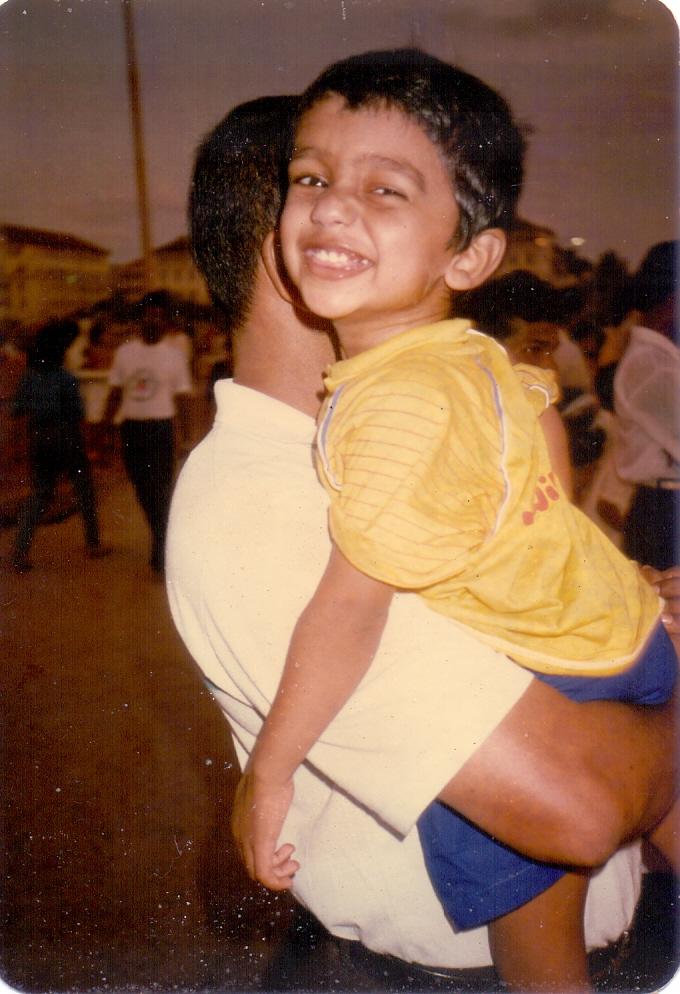
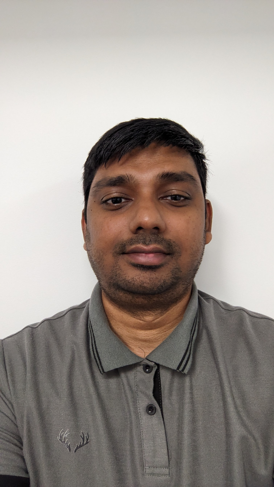
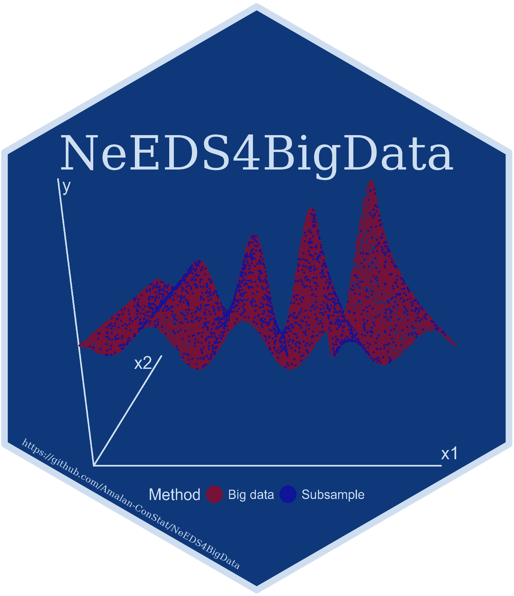
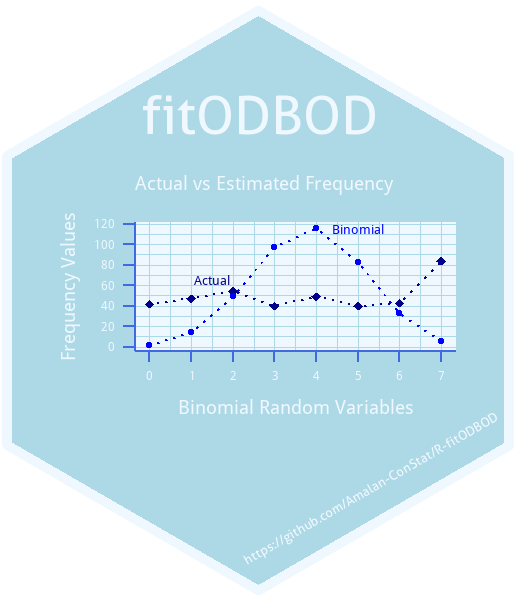
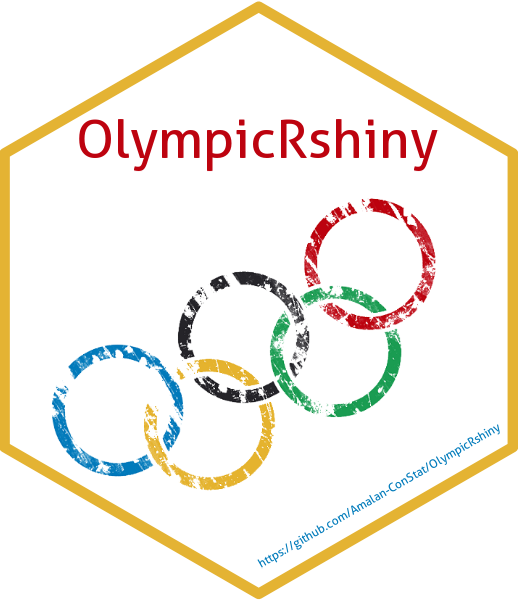
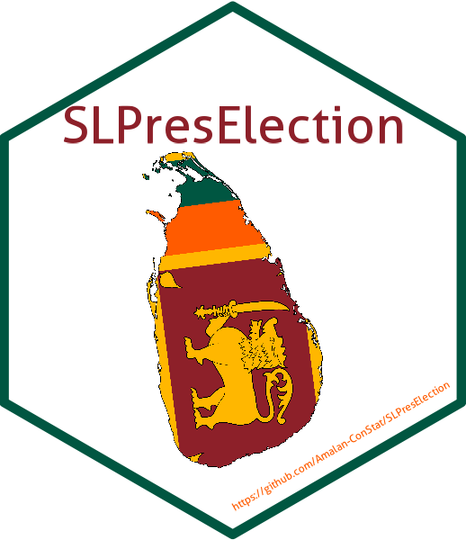
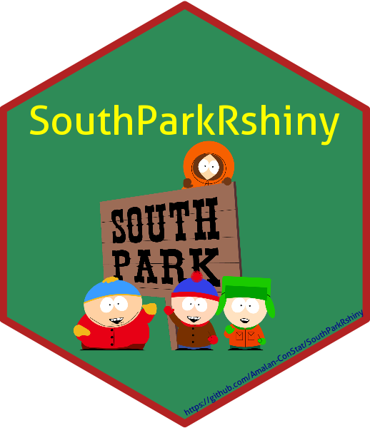
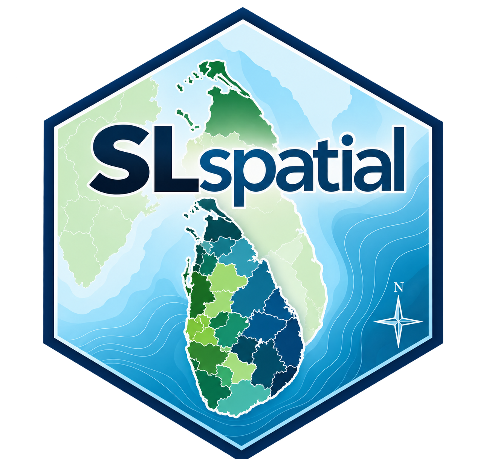

::: {#about-block}

::: {.about-intro}

::: {.about-images}

:::

::: {.about-text}

I am a Postdoctoral Research Fellow working at the School of Civil and Environmental Engineering, Queensland University of Technology (QUT). 
I currently apply my skills to transport research, including crash safety in network level when traffic modelling, road safety, travel-demand analysis, heavy-vehicle safety, and pavement deterioration modelling.

Recently obtained my PhD in Statistical Theory from the School of Mathematical Sciences, QUT working on "New methods of experimental design for subsampling under big data". 

I completed my Bachelor of Science (Statistics Special) on the subjects Statistics, Mathematics and Computer Science from the University of Peradeniya, Sri Lanka. 

I am interested in applying statistical methods efficiently and effectively through the R statistical programming language. 
Conducting complex computations, writing reports and publishing them through R is my special skill over 10 years of experience.

I am proficient in R and its associated ecosystem, including base R, tidyverse, ggplot2, Shiny, golem, bookdown, rmarkdown and Quarto. 
My broader experience includes statistical modelling, big-data analytics, data visualisation, spatial analysis, reproducible research, R package development, and the development of interactive analytical applications.  

:::

:::

I have developed the below listed R packages and Shiny apps:

::: columns

::: {.column width="80%"}
1. [NeEDS4BigData](https://cran.r-project.org/package=NeEDS4BigData) : Implementing subsampling methods to find informative samples from big data
:::

::: {.column width="20%"}
{width=20%,height=25%}
:::

::: {.column width="80%"}
2. [fitODBOD](https://cran.r-project.org/package=fitODBOD) and [fitODBODRshiny](https://cran.r-project.org/package=fitODBODRshiny): Modeling Over Dispersed Binomial Outcome Data Using BMD and ABD
:::

::: {.column width="20%"}
{width=20%,height=25%}
:::

::: {.column width="80%"}
3. [OlympicRshiny](https://cran.r-project.org/package=OlympicRshiny): 'Shiny' Application for Olympic Data
:::

::: {.column width="20%"}
{width=20%,height=25%}
:::

::: {.column width="80%"}
4. [SLPresElection](https://cran.r-project.org/package=SLPresElection): Presidential Election Data of "Sri Lanka" from 1982 to 2024.
:::

::: {.column width="20%"}
{width=20%,height=25%}
:::

::: {.column width="80%"}
5. [SouthParkRshiny](https://cran.r-project.org/package=SouthParkRshiny): Script data and rating and votes data for the tv show "SouthPark" was web scraped until season 28 is stored as data and an [Rshiny](https://amalan-con-stat.shinyapps.io/SouthParkRshiny/) application.
:::

::: {.column width="20%"}
{width=20%,height=25%}
:::

::: {.column width="80%"}
6. [SLspatial](https://cran.r-project.org/package=SLspatial): Spatial Data for Sri Lanka.
:::

::: {.column width="20%"}
{width=20%,height=25%}
:::

On this website, I offer a glimpse into my vast body of knowledge, ongoing research, publications, conference posters and my interests.
If you are interested in my work and have any questions or would like to discuss do not hesitate to [contact me](mailto:mail.amalan0595@gmail.com)
:::

:::
