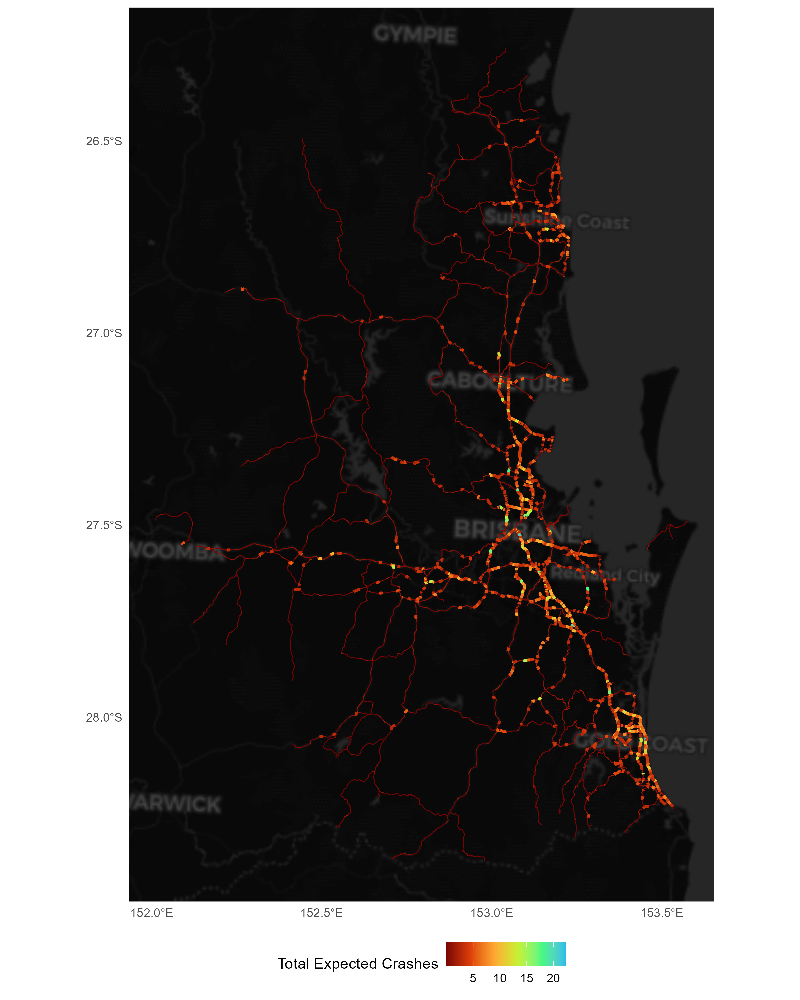
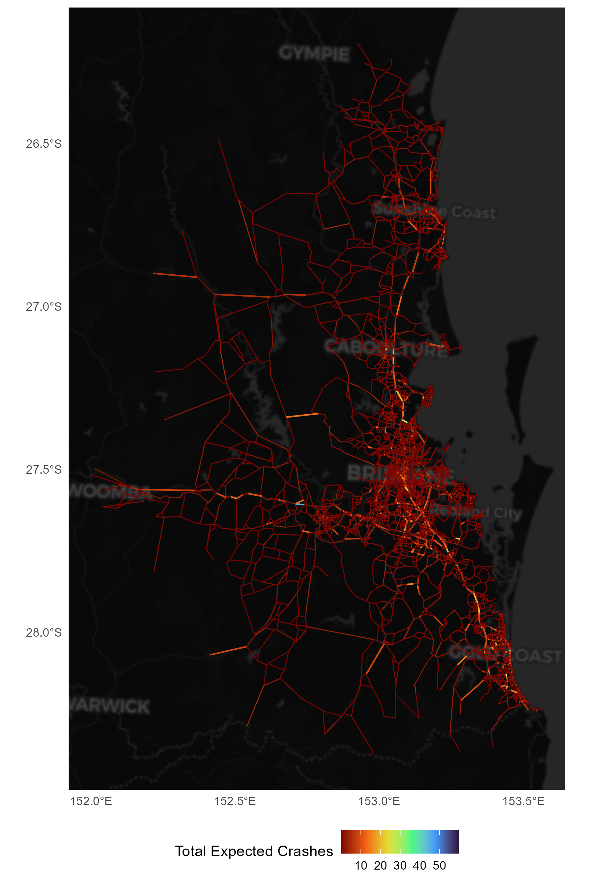
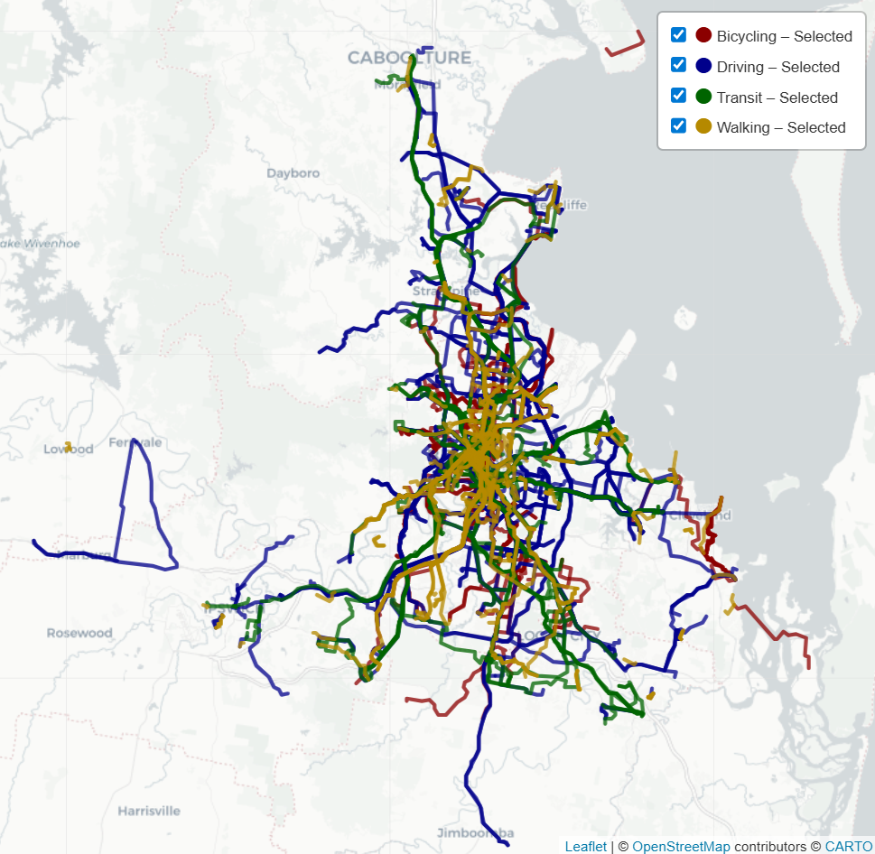
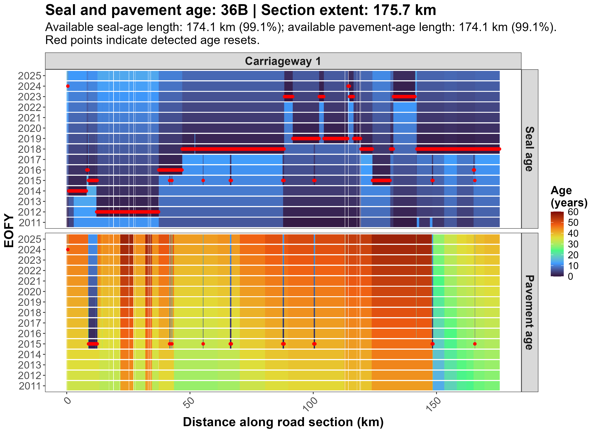

## Research Fellow in Transport Engineering and Planning

I am a Research Fellow in Transport Engineering and Planning at the School of Civil and Environmental Engineering, Queensland University of Technology (QUT). 
My research applies statistical modelling, data science, spatial analysis, and data visualisation to transport engineering problems, with a particular focus on road safety, travel behaviour, heavy vehicles, and pavement performance.

My role involves working with large and complex transport datasets, developing and evaluating appropriate statistical models, preparing reproducible analyses, and communicating findings through technical reports, presentations, figures, and research outputs for academic and industry partners.

----

## Research Approach

Across these projects, my work combines statistical methodology with applied transport engineering problems. 
I use R extensively for data cleaning, statistical modelling, visualisation, spatial analysis, reproducible reporting, and the processing of large datasets.

A recurring theme in my research is transforming complex transport data into interpretable statistical evidence that can support engineering analysis and decision-making. 
This includes working with road-segment-level and spatial datasets, developing statistical models appropriate to the structure of the data, and communicating results through technical reports, research publications, presentations, and visualisations.

----

## Incorporating Road Safety Throughout the Network-Level Transport Planning Process

This project investigates how road safety can be incorporated directly into network-level transport planning. I developed and evaluated crash prediction models across different road stereotypes and crash types in Queensland.

:::: {.columns}

::: {.column width="48%"}

{.project-paired-image}

**Spatial distribution of expected crashes across the Southeast Queensland road network.**

:::

::: {.column width="48%"}

{.project-paired-image}

**Expected crashes across the Southeast Queensland transport network.**

:::

::::

A major component of the project involved estimating expected crashes at the 100 m road-segment level and integrating these estimates into the Southeast Queensland transport network. 
The resulting road-safety information was subsequently incorporated into SA2-level origin–destination analyses, providing a framework for considering expected crash outcomes alongside network-level travel patterns.

My work on this project included statistical modelling, preparation and integration of spatial and transport datasets, development of figures and visualisations, and coordination of project reports.

**Key areas:** Crash prediction modelling · Road safety · Network-level planning · Spatial analysis · Origin–destination analysis · Statistical modelling

----

## Active Transport and Travel Demand in Brisbane: Insights from Survey and Smart Travel Diary Data

This project examines travel behaviour and active transport patterns across Greater Brisbane using travel survey and smart travel diary data.

::: {.project-figure}

{.project-single-image}

**Origin–destination travel patterns across Greater Brisbane derived from travel survey data.**

:::

Working as a transport analyst, I analysed travel survey data and developed origin–destination visualisations to investigate travel patterns across Greater Brisbane. 
The analysis supported the interpretation and communication of spatial travel-demand patterns and contributed to research outputs from the project.

**Key areas:** Active transport · Travel demand · Travel surveys · Origin–destination analysis · Data visualisation · Brisbane

----

## Study of the Effect of Heavy Vehicle Size on Crash Rates in Queensland

This project investigates the relationship between heavy vehicle characteristics and crash rates across Queensland.

I collaborated with engineers from the Queensland Department of Transport and Main Roads (TMR) to develop crash count models and estimate crash rates for different heavy vehicle types. 
The statistical analysis was used to examine differences in crash occurrence and crash rates across vehicle categories.

In addition to the modelling, I prepared and maintained technical reports and developed figures and tables to communicate the analytical results to project stakeholders.

**Key areas:** Heavy vehicles · Crash count modelling · Crash rates · Road safety · Statistical modelling · Technical reporting

## Analysing Meteorological Data and Pavement Performance Statistics to Optimise Maintenance Prioritisation and Reduce Whole-of-Life Cost

This project investigates pavement deterioration across the Queensland road network by combining pavement-condition, road-attribute, traffic, and meteorological information.

::: {.project-figure}

{.project-single-image}

**Spatial and temporal variation in pavement and seal age along Road Section 36B.**

:::

The analysis involves more than two million records representing approximately 100 m road segments across Queensland. 
The resulting longitudinal dataset provides repeated observations of pavement and environmental conditions and enables deterioration to be examined across both space and time.

My work involves extensive data cleaning and preparation, integration of pavement and meteorological datasets, exploratory and spatial analysis, and statistical modelling. 
Generalised Clusterwise Regression is being applied to identify pavement deterioration patterns and develop cluster-specific deterioration models.

The broader objective is to better understand variation in pavement deterioration and provide quantitative evidence that can support pavement maintenance prioritisation and whole-of-life cost management.

**Key areas:** Pavement deterioration · Big data · Longitudinal data · Meteorological data · Generalised Clusterwise Regression · Spatial analysis · Statistical modelling
